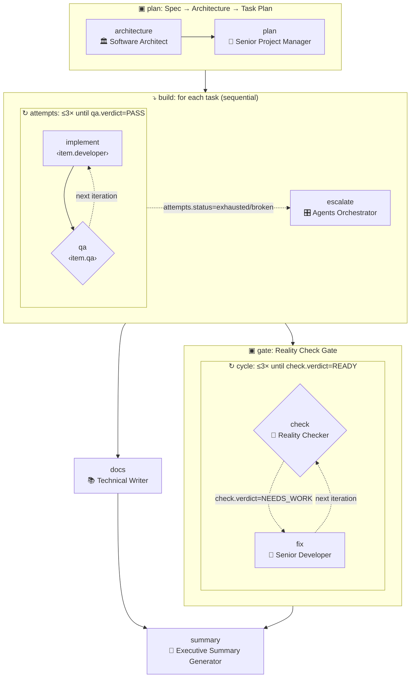

# 🕸️ Team Graphs — composable, automated agent teams

The agents in this repo are individual specialists. The NEXUS playbooks and
runbooks describe how they work *together*, but only as prose a human (or an
orchestrator agent) has to follow by hand. **Team graphs make that executable.**

A team graph is a small JSON program whose instructions are agents. It says who
works, in what order, what runs in parallel, which agent's verdict decides what
happens next, and which work repeats until it passes. `scripts/agency_graph.py`
checks it and runs it, unattended, against Claude Code or the Claude API.

```bash
python3 scripts/agency_graph.py list                           # teams and building blocks
python3 scripts/agency_graph.py show feature-delivery          # structure, roster, worst-case cost
python3 scripts/agency_graph.py mermaid startup-mvp --expand   # diagram, sub-teams inlined
python3 scripts/agency_graph.py run feature-delivery -i spec="..."   # dry run (mock backend)
```

---

## Design in one page

Getting "composable + automated + loops + graph" right comes down to a few
decisions. Each one is there to keep an unattended multi-agent run
**predictable, bounded, and debuggable**.

| Decision | Why |
|---|---|
| **The DAG of `after` edges is the only way to order work; iteration only happens in `loop` nodes.** No arbitrary back-edges. | A free-form cyclic graph can't be checked before it runs: it could loop forever, and it is unclear what state each re-entry sees. A DAG plus explicit, bounded loops is structured programming. Termination is guaranteed, and `validate` prints the **worst-case number of agent calls** before you spend anything. |
| **Five node types: `agent`, `gate`, `graph`, `loop`, `map`.** | These are the patterns that already appear in the NEXUS docs: a specialist call, a quality verdict, a sub-team, the Dev↔QA retry loop, and fan-out over a task list. Parallelism needs no node type: nodes with no dependency between them run concurrently. |
| **Gates turn prose into control flow.** A gate must end with `VERDICT: <X>` from a declared list, for example `PASS/FAIL/BLOCKED` or `READY/NEEDS_WORK`. | Branching (`when`) and loop exit (`until` / `break`) run on a single parsed word, not on free text. A missing or unknown verdict counts as `BLOCKED`, or as the gate's last listed verdict, which by convention is the most conservative one. A gate can't pass by accident. |
| **Composition is by reference.** A `graph` node, or a loop/map `body`, calls another graph with typed `inputs`, and that graph returns named `outputs`. | Graphs work like functions. `dev-qa-loop` is written once and reused by `feature-delivery` (once per task) and `incident-response`, and `feature-delivery` is itself a sub-team inside `startup-mvp`. Recursion is rejected. |
| **Agents are parameters.** An input declared `"type": "agent"` can be filled at run time, even by another agent's output (`{{item.developer}}`). | A PM agent can decide that task T3 goes to the Backend Architect with the API Tester as QA, and the next node follows that decision. Unknown slugs fall back to the input's default instead of crashing the run. |
| **Every agent call is checkpointed.** | Loops and fan-outs are the long, expensive part. `--max-calls` stops cleanly, and `--resume` replays finished calls from cache, so a crash or budget stop loses nothing. |
| **Static validation in CI.** | Renaming an agent breaks every team that calls it. `check-graphs.yml` runs on every PR, the same way `check-runbooks.yml` does. |

---

## The library

**Teams** are runnable deliverables. **Blocks** are sub-teams meant to be composed.

| Graph | Kind | What it does |
|---|---|---|
| `dev-qa-loop` | block | Developer implements → QA gate (`PASS/FAIL/BLOCKED`) → retry with feedback ≤3× → escalate to the Agents Orchestrator if exhausted or blocked. |
| `review-loop` | block | Author drafts → reviewer gate (`APPROVED/REVISE/REJECTED`) → revise ≤3×. For any non-code artifact. |
| `spec-to-tasks` | block | Software Architect → Senior PM emits a JSON task list; each task names its developer and QA agent from a pool. |
| `quality-gate` | block | Reality Checker (`READY/NEEDS_WORK`) ↔ fixer, ≤3 checks. |
| `feature-delivery` | team | `spec-to-tasks` → **map** over tasks, each through `dev-qa-loop` → `quality-gate` ∥ docs → executive summary. |
| `startup-mvp` | team | market research ∥ user research → PM brief → **`feature-delivery` as a sub-team** → launch squad *if READY*, otherwise a recovery plan. |
| `incident-response` | team | triage → SRE ∥ security gate (→ containment if needed) ∥ comms → verified fix via `dev-qa-loop` → post-mortem. |
| `content-engine` | team | campaign strategy → **parallel map** over channels, each through `review-loop` → distribution calendar. |
| `growth-experiment-loop` | team | hypothesis → experiment design → analysis → decision gate (`SCALE/ITERATE/KILL`), ≤4 cycles. |
| `pr-hardening` | team | code review ∥ security review → minimal-change fixes → re-review until **both** pass, ≤3 rounds. |

`strategy/runbooks.json` links each NEXUS runbook to the graph that automates
it through a `graph` field.

### Example: `feature-delivery`, expanded



---

## Running a team

### Backends

| Backend | What happens | Use it for |
|---|---|---|
| `mock` (default) | Deterministic fake outputs. Gate verdicts are scripted with `--mock-verdict qa=FAIL,FAIL,PASS`. | Checking wiring, branch paths, and loop behaviour before spending tokens. It is also what CI uses. |
| `claude-code` | Each agent is a headless `claude -p` session in `--workdir`, with the agent's prompt appended to the system prompt. Developers edit files, QA runs tests. | Real software work in a repository. |
| `anthropic` | Each agent is one Claude API call through the official `anthropic` SDK (`pip install anthropic`), defaulting to `claude-opus-5-5` with adaptive thinking. | Research, planning, writing, and analysis teams that don't need file access. |

```bash
# Dry run: watch the Dev↔QA loop fail twice, then pass
python3 scripts/agency_graph.py run dev-qa-loop -i task="Add rate limiting" \
  --mock-verdict qa=FAIL,FAIL,PASS

# Real run in a repo, with a budget
python3 scripts/agency_graph.py run feature-delivery \
  --input-file spec=docs/spec.md \
  --backend claude-code --workdir ~/code/myapp \
  --claude-args "--permission-mode acceptEdits" \
  --max-calls 40

# Continue after a budget stop, Ctrl-C, or crash
python3 scripts/agency_graph.py run --resume ~/code/myapp/.agency-runs/feature-delivery-20260928-101500
```

Useful flags: `--max-parallel N` (concurrent agent calls, default 4),
`--model`, `--effort`, `--run-dir`, `-q`. Inputs that look like JSON
(`-i channels='["blog","x"]'`) are parsed as JSON.

### What a run leaves behind

```
.agency-runs/<graph>-<timestamp>/
├── state.json            # checkpoint: every finished agent call (used by --resume)
├── events.jsonl          # timeline: calls, verdicts, skips, loop outcomes
├── report.md             # final outputs + call log with verdicts
└── nodes/
    ├── <path>.md         # each agent's full output
    └── <path>.prompt.md  # the exact handoff it received
```

Node paths are hierarchical and unique, for example
`startup-mvp/deliver/build/item-2/attempts/iter-3/qa`, so every retry of every
task in every sub-team has its own record.

### Loops over time (scheduled automation)

A `loop` node iterates *within* a run. To iterate *across* runs, for example a
weekly growth cycle fed with fresh metrics, schedule the command. Each run is
cheap to validate and bounded by `--max-calls`:

```yaml
# .github/workflows/weekly-growth.yml (example — needs an ANTHROPIC_API_KEY secret)
on:
  schedule: [{ cron: "0 8 * * 1" }]
jobs:
  growth:
    runs-on: ubuntu-latest
    steps:
      - uses: actions/checkout@v4
      - run: pip install anthropic
      - run: |
          python3 scripts/agency_graph.py run growth-experiment-loop \
            -i goal="Raise week-1 activation from 22% to 30%" \
            --input-file data=metrics/latest.md \
            --backend anthropic --max-calls 20 --run-dir runs/growth
        env: { ANTHROPIC_API_KEY: "${{ secrets.ANTHROPIC_API_KEY }}" }
      - uses: actions/upload-artifact@v4
        with: { name: growth-report, path: runs/growth/report.md }
```

The same command also works from `cron` or from Claude Code's `/loop`.

### Installing just the team you need

`roster` lists every agent a graph can call, including agents from nested
sub-teams and dynamic assignment pools:

```bash
./scripts/install.sh --tool claude-code --agent "$(python3 scripts/agency_graph.py roster startup-mvp --csv)"
```

---

## Format reference

```jsonc
{
  "slug": "my-team",               // must equal the file name
  "title": "My Team",
  "kind": "team",                  // "team" (runnable) | "block" (reusable sub-team)
  "summary": "One line: what this team delivers.",
  "inputs": {
    "spec":      { "description": "...", "required": true },
    "developer": { "type": "agent", "default": "engineering-senior-developer" }
  },
  "pool": ["..."],                 // optional: agents that may be assigned at run time
  "nodes": [ /* see below */ ],
  "outputs": { "result": "{{nodes.last.output}}", "verdict": "{{nodes.gate.verdict}}" }
}
```

Every node has an `id` and a `type`, and may have `after` (list of upstream
node ids) and `when` (a condition; if it is false the node is **skipped**).

| Type | Fields |
|---|---|
| `agent` | `agent` (slug, `{{input.x}}` or `{{item.x}}`), `task` (template). Optional: `output: "json"` (parsed from a ```` ```json ```` block, with one automatic repair call), `schema_hint`, `mock`, `context` (upstream ids to attach; defaults to `after`), `model`, `effort`, `fallback_agent`. |
| `gate` | Everything `agent` has, plus `verdicts` (default `["PASS","FAIL","BLOCKED"]`) and `verdict_guide`. |
| `graph` | `graph` (slug), `inputs` (templates). |
| `loop` | `max_iterations` (1–10, required), `until` (condition; stop, success), optional `break` (condition; stop, failure), optional `feedback` (template for what the next iteration sees; default: the `until` nodes' output), `body`. |
| `map` | `items` (`"nodes.<id>.json"`, `"nodes.<id>.outputs.<name>"`, `"input.<name>"`, or a literal list), `max_items` (default 20), `max_parallel` (default 1), optional `pass_verdicts`, `body`. |

A `body` is either inline (`{"nodes": [...], "outputs": {...}}`, which can read
the enclosing graph's inputs and upstream nodes) or a call
(`{"graph": "<slug>", "inputs": {...}}`). Inside a graph body, `until` and
`break` refer to the called graph as the node `body`.

**Templates:** `{{input.<name>}}`, `{{nodes.<id>.output|verdict|status|iterations|json|outputs.<name>}}`,
`{{item}}` / `{{item.<field>}}` (inside a map), `{{loop.iteration}}`,
`{{loop.max}}`, `{{loop.feedback}}` (inside a loop). A template that is exactly
one reference keeps its type, so a list stays a list.

**Conditions:** `{"node": "qa", "verdict": "PASS"}` or `{"node": "x", "status": ["exhausted", "broken"]}`.
Add `"negate": true` to invert. Combine with a list (AND), `{"all": [...]}`, or `{"any": [...]}`.
The statuses are `done`, `skipped`, `passed`, `broken`, and `exhausted` (the last three are for loops).

**What each agent receives:** a handoff document with the team mission, run
inputs, its task, the work item (in a map), iteration number and feedback (in a
loop), each upstream teammate's output, and an output contract (verdict line or
JSON block). The agent's own `.md` file is its system prompt, followed by a
short protocol that says it is running unattended: make assumptions instead of
asking questions.

### Validation rules (`validate`, enforced in CI)

- Every agent slug resolves to an agent file, including input defaults and `pool` entries.
- `after` edges form a DAG. Every loop is bounded. Graph references never recurse.
- Templates, `when`, and `context` read only nodes that are upstream. `{{item}}` is only used inside a map, and `{{loop}}` only inside a loop.
- Conditions only test verdicts that the gate can actually return.
- A sub-team call provides every required input and no unknown inputs.

### Adding a team

1. Write `strategy/graphs/<slug>.json`, reusing blocks where possible.
2. Run `python3 scripts/agency_graph.py validate <slug>` and `show <slug>`.
3. Dry-run every branch with `--mock-verdict` (for example, force the gate to fail and check that escalation runs).
4. Run `./scripts/check-graphs.sh`.
